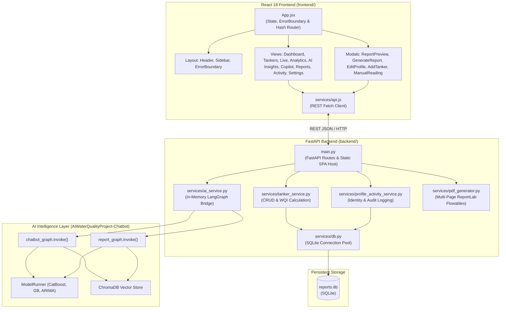

# AquaVision — Main Development & Integration Subproject

[](https://react.dev)
[](https://fastapi.tiangolo.com)
[](https://tailwindcss.com)
[](https://vitejs.dev)
[](https://sqlite.org)

This subproject directory represents the **core application and integration layer** of the AquaVision platform. It encompasses the responsive React single-page frontend, the asynchronous FastAPI backend, the persistent SQLite database, the multi-page ReportLab PDF laboratory exporter, and the in-memory AI bridge that links user actions with the pre-trained machine learning models and LangGraph intelligence agents.

---

## Architecture Overview



---

## Subproject Directory Structure

```
AIWaterQualityProject-AquaVision/
│
├── backend/                                # FastAPI Asynchronous Server
│   ├── main.py                             # API Entry Point & Static SPA Hosting
│   ├── services/
│   │   ├── db.py                           # SQLite Database Setup & Migrations
│   │   ├── tanker_service.py               # Fleet Management, Readings & Analytics
│   │   ├── profile_activity_service.py     # Profile Persistence & Audit Trail
│   │   ├── ai_service.py                   # In-Memory Bridge to LangGraph
│   │   ├── pdf_generator.py                # Multi-Page ReportLab PDF Builder
│   │   └── report_store.py                 # Report Queries & Serialization
│   ├── reports.db                          # Persistent SQLite Database
│   └── requirements.txt                    # Backend Python Dependencies
│
├── frontend/                               # React 18 Application (Vite + Tailwind)
│   ├── src/
│   │   ├── App.jsx                         # Main Component & Route Orchestration
│   │   ├── main.jsx                        # React DOM Root Entry
│   │   ├── index.css                       # Global Tailwind Styles & Fonts
│   │   ├── services/
│   │   │   └── api.js                      # Centralized REST API Client
│   │   └── components/
│   │       ├── ErrorBoundary.jsx           # Catch-All Runtime Error Protection
│   │       ├── Header.jsx                  # Top Bar with Profile Trigger
│   │       ├── Sidebar.jsx                 # Navigation Bar with Badges
│   │       ├── modals/
│   │       │   ├── ReportPreviewModal.jsx  # Defensive Data Preview Modal
│   │       │   ├── GenerateReportModal.jsx # Lab Audit Generator Modal
│   │       │   ├── EditProfileModal.jsx    # User Identity Editor
│   │       │   ├── AddTankerModal.jsx      # Tanker Registration Modal
│   │       │   └── ManualReadingModal.jsx  # Telemetry Entry Modal
│   │       └── views/
│   │           ├── DashboardView.jsx       # 4-KPI Overview & Waveform
│   │           ├── TankerManagementView.jsx# Dedicated Fleet CRUD Grid
│   │           ├── LiveMonitoringView.jsx  # Telemetry Streams & Calibrator
│   │           ├── AnalyticsView.jsx       # Parameter Distribution & CSV
│   │           ├── AIInsightsView.jsx      # Guideline Screening
│   │           ├── AIAssistantView.jsx     # AI Copilot Interface
│   │           ├── ReportsView.jsx         # Reports Archive
│   │           ├── ActivityView.jsx        # Audit Trail
│   │           └── SettingsView.jsx        # System Preferences
│   ├── dist/                               # Production Static Distribution
│   ├── index.html                          # HTML5 Entry Shell
│   ├── vite.config.js                      # Vite Bundler Configuration
│   ├── tailwind.config.js                  # Tailwind Theme & Color System
│   └── package.json                        # Frontend Node Dependencies
│
├── docs/                                   # Subproject Documentation Assets
│   └── assets/screenshots/                 # Actual Interface Screenshots
├── run_aquavision.py                       # Subproject Local Launcher
├── .env.example                            # Subproject Environment Template
└── README.md                               # Subproject Documentation
```

---

## Detailed Component & Feature Implementation

### 1. Zero-White-Screen Report Modal ([`ReportPreviewModal.jsx`](src/components/modals/ReportPreviewModal.jsx))
- **Defensive Data Parsing**: Inspects `report.structured_data` dynamically. If stored as a JSON string in SQLite, it parses it safely into an object with fallback protection.
- **Ensemble Inference Normalization**:
  - Handles `class_probabilities` regardless of structure (array of dictionaries with `class_name` & `probability`, raw object key-values, or tuples).
  - Handles 5-year ARIMA projections extracting `predicted_risk_score`, `predicted_wqi`, or `forecast`.
- **Standards Table**: Renders all evaluated telemetry parameters against Pakistan NSDWQ and WHO limits with color-coded compliance badges (`PASSED`, `BORDERLINE`, `VIOLATION`).

### 2. Fleet Management & Telemetry Influx ([`TankerManagementView.jsx`](src/components/views/TankerManagementView.jsx))
- **Dynamic CRUD**: Add new tankers, update metadata, log calibrated telemetry, or delete tankers with confirmation.
- **Live Filtering**: Search across IDs, locations, and filter by status (`Normal`, `Warning`, `Critical`).
- **Telemetry Influx**: Boundary validation on manual reading influx:
  $$\text{pH} \in [0.0, 14.0], \quad \text{TDS} \ge 0 \text{ mg/L}, \quad \text{Turbidity} \ge 0 \text{ NTU}$$

### 3. Non-Blocking AI Copilot & Conversation Hub ([`AIAssistantView.jsx`](src/components/views/AIAssistantView.jsx))
- **Maximized Vertical Chat Area**: Redesigned into a high-efficiency layout where the conversation viewport occupies over 75% of the screen height with independent smooth scrolling, eliminating page-length overflow.
- **Sleek Single-Row Control Bar**: Consolidates scope selection, active context grounding pill, Gemini model status badge, and conversation reset into a compact ~42px header.
- **Dual Conversation Grounding**:
  - **Overall Fleet Scope**: Access to live tanker counts, cross-tanker comparisons, regional distribution hubs, and water science fundamentals.
  - **Individual Tanker Scope**: Dynamic grounding in specific tanker telemetry (pH, TDS, Turbidity, Nitrate, etc.) and Pakistan NSDWQ thresholds.
- **Compact Horizontal Quick Prompts**: Single-row horizontal scroll bar (`overflow-x-auto`) providing realistic suggested queries without squishing the message area.
- **Session Memory & Failover Chain**: Primary requests execute against `gemini-3.1-flash-lite`, failing over seamlessly to `gemini-3.5-flash-lite` or rich local deterministic fallbacks if offline.
- **Interactive Embedded Cards**: When a user asks the copilot to generate an official laboratory report, the agent embeds an interactive report card directly inside the chat bubble with one-click preview and PDF download.

---

## AI Assistant — Testing Prompts & Grounded Scenarios

The AquaVision AI Copilot is grounded in live application data and authoritative regulatory standards (Pakistan NSDWQ and WHO). Below are recommended testing prompts categorized by operational and analytical focus:

### 1. General & Fleet-Wide Queries (`Overall Context`)
Select **"🌐 Overall Fleet"** in the top scope selector:
- `How many tankers are currently registered?`
  - *Expected Result:* Returns the exact registered fleet count from SQLite and lists monitored regional hubs across Pakistan.
- `Compare the water quality of all registered tankers`
  - *Expected Result:* Provides a structured comparative breakdown of all tankers with WQI scores, primary telemetry readings, and status indicators.
- `Which tanker currently has the best water quality readings?`
  - *Expected Result:* Dynamically identifies the top-performing distribution unit with optimal WQI and parameter compliance.
- `Which water quality parameters need the most attention?`
  - *Expected Result:* Highlights critical parameters approaching or exceeding regulatory ceilings across the fleet.

### 2. Targeted Tanker Inquiries (`Individual Tanker Context`)
Select an individual unit (e.g., **"🚚 TANK-02: North Sector Reservoir"**) in the top scope selector:
- `Give me a complete overview of this tanker's water quality`
  - *Expected Result:* Returns a diagnostic assessment of the selected tanker's location, source type, WQI rating, and parameter readings.
- `Which parameters are outside their recommended ranges?`
  - *Expected Result:* Compares the tanker's live measurements against Pakistan NSDWQ limits and flags any deviations.
- `Explain the latest readings in simple language`
  - *Expected Result:* Translates technical chemical metrics into easy-to-understand explanations for field operators.
- `What actions would you recommend to improve this tanker's water quality?`
  - *Expected Result:* Offers targeted remediation advice (e.g., sand microfiltration, chlorination adjustment, tank sediment flushing).
- `Generate an official water quality report for this tanker`
  - *Expected Result:* Triggers LangGraph multi-node report generation and returns an embedded interactive card with one-click preview and PDF download.

### 3. Water Science & Educational Questions
Works seamlessly in both Overall and Individual contexts:
- `What is the difference between TDS and turbidity?`
  - *Expected Result:* Explains that TDS measures dissolved mineral ions (< 2 µm, in mg/L), while Turbidity measures suspended particles scattering light (in NTU), along with their distinct health implications.
- `Why is pH important in drinking water?`
  - *Expected Result:* Explains the 6.5–8.5 standard, pipe corrosion at low pH (< 6.5), and compromised chlorine disinfection efficacy at high pH (> 8.0).
- `What can cause high turbidity in drinking water?`
  - *Expected Result:* Details surface runoff, pipe biofilm disturbance, algal blooms, and coagulation-flocculation treatments.
- `What are the health risks of high nitrate levels for children?`
  - *Expected Result:* Details infant methemoglobinemia ("blue baby syndrome"), impaired oxygen transport, and the 50 mg/L regulatory limit.

### 4. WQI & Predictive Inference
- `Explain how the Water Quality Index (WQI) works`
  - *Expected Result:* Explains parameter weighting, sub-index calculation relative to standard limits, and AquaVision's 5-tier classification scale (0–50 Excellent to >300 Unsuitable).
- `Predict WQI for pH 7.2 and TDS 450`
  - *Expected Result:* Runs the CatBoost regressor, notes that unmeasured variables were imputed using regional baseline training medians, and predicts the WQI score and quality tier.

### 5. Conversational & Introductory Queries
- `Hi, what can you help me with?`
  - *Expected Result:* Friendly, structured overview of capabilities, telemetry monitoring, standards grounding, and report generation.

### 4. Overlap-Proof Multi-Page ReportLab PDF Generator ([`pdf_generator.py`](backend/services/pdf_generator.py))
- Uses ReportLab `SimpleDocTemplate` with custom flowables.
- Headings are assigned `keepWithNext=True` to eliminate orphan headers.
- Tables and summaries are wrapped in `KeepTogether` containers preventing table-header overlap across page boundaries.

---

## Running the Subproject

### Option A: Unified Full-Stack Server (Recommended)
From this directory:
```bash
python run_aquavision.py
```
This runs the FastAPI backend on port 8000 and serves the compiled React frontend directly from `frontend/dist`.

### Option B: Independent Development Mode
For live hot-reloading during development:

1. **Start the FastAPI Backend**:
   ```bash
   cd backend
   python -m uvicorn main:app --host 127.0.0.1 --port 8000 --reload
   ```

2. **Start the Vite Frontend**:
   ```bash
   cd frontend
   npm run dev
   ```
   Open `http://localhost:5173`. Vite automatically proxies `/api` calls to `http://localhost:8000`.

---

## Division of Responsibilities

| Capability / Module | Original AI Team (`AIWaterQualityProject-Chatbot`) | AquaVision Platform (`AIWaterQualityProject-AquaVision`) |
| :--- | :---: | :---: |
| Pre-trained ML Models (Gradient Boosting, CatBoost, ARIMA) | **Author & Custodian** | In-Memory Consumer via `ModelRunner` |
| ChromaDB Standards & Methodology Ingestion | **Author & Custodian** | In-Memory Querying via LangGraph |
| CLI Chatbot & Question Routing Logic | **Author & Custodian** | Connected to REST API & UI |
| React 18 Single-Page Application (SPA) | Not Included | **Author & Custodian** |
| Modernized Responsive UI & Design System | Not Included | **Author & Custodian** |
| FastAPI Asynchronous REST API | Not Included | **Author & Custodian** |
| SQLite Database & Data Persistence Layer (`reports.db`) | Not Included | **Author & Custodian** |
| Multi-Tanker Fleet Management & Field Telemetry Influx | Not Included | **Author & Custodian** |
| Dynamic Telemetry Waveform & Statistical Distribution | Not Included | **Author & Custodian** |
| Multi-Page ReportLab PDF Generator | Not Included | **Author & Custodian** |
| Editable User Scientist Profile & Audit Trail System | Not Included | **Author & Custodian** |
| Zero-Config Full-Stack Launchers | Not Included | **Author & Custodian** |

---

## Troubleshooting Guide

### 1. `Google Gemini API Quota (429 RESOURCE_EXHAUSTED)`
- **Solution**: In `.env`, ensure `GEMINI_MODEL=gemini-3.1-flash-lite`. The Flash-Lite model provides immediate inference without the strict rate quotas encountered on preview models.

### 2. `ModuleNotFoundError: No module named 'src'`
- **Solution**: The backend automatically adds `AIWaterQualityProject-Chatbot` to `sys.path`. When running tests independently from the command line, export the path:
  ```powershell
  $env:PYTHONPATH="AIWaterQualityProject-Chatbot"
  ```

### 3. Blank Screen on Older Builds
- **Solution**: Ensure you are running the latest compiled frontend:
  ```bash
  cd frontend
  npm run build
  ```
  The latest build contains defensive parsing and the catch-all `ErrorBoundary`.
