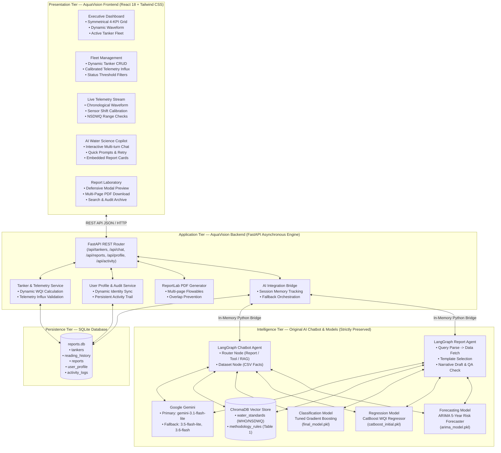
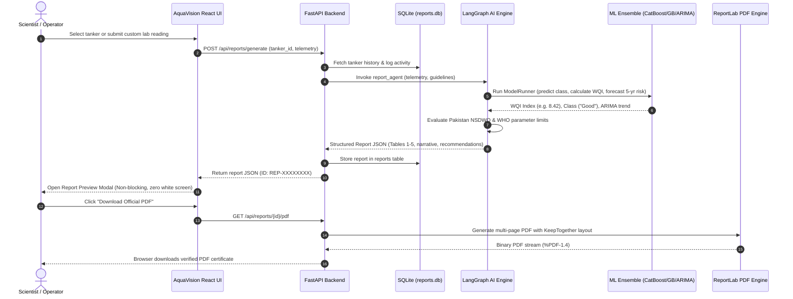
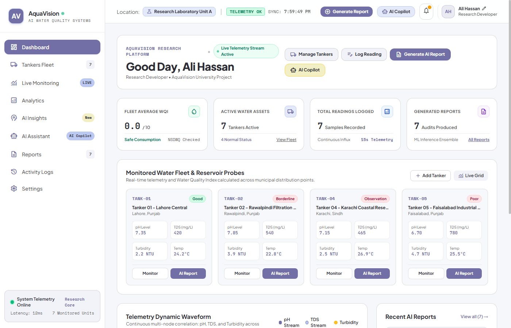
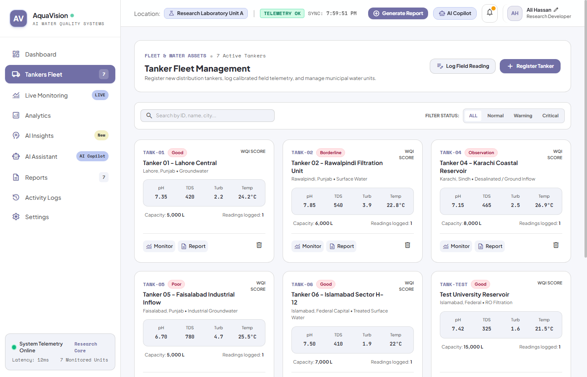
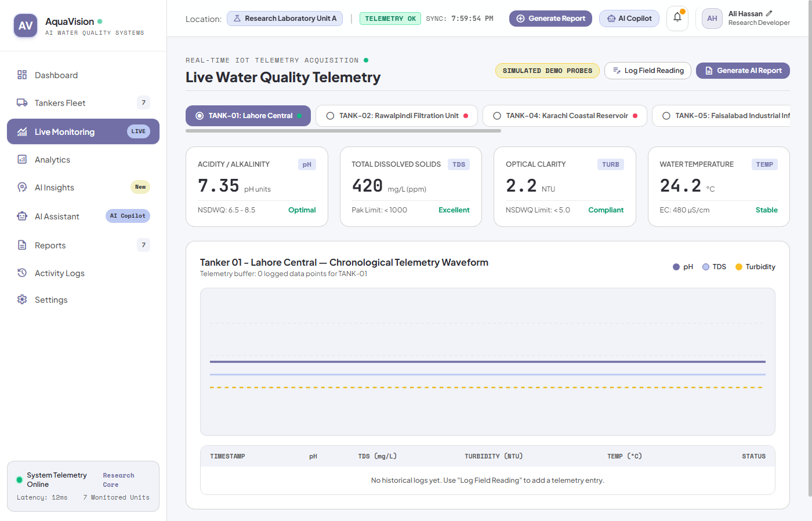
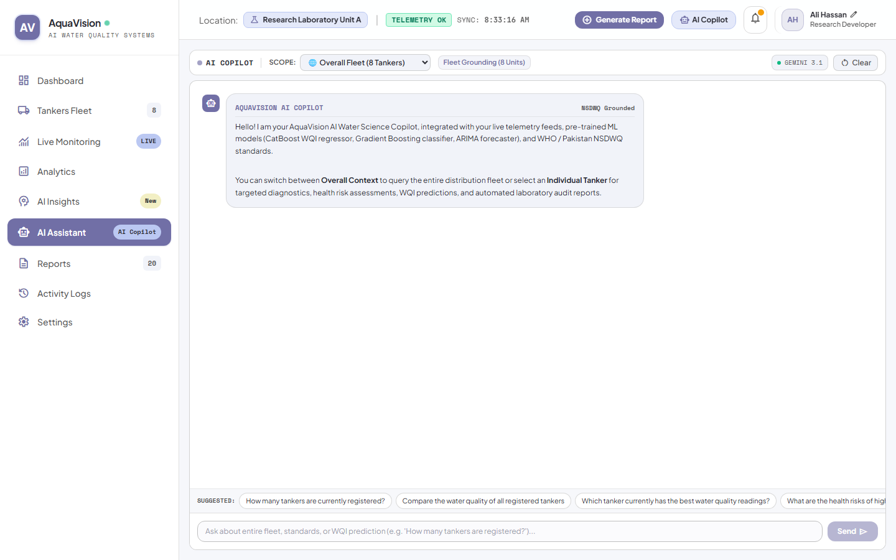
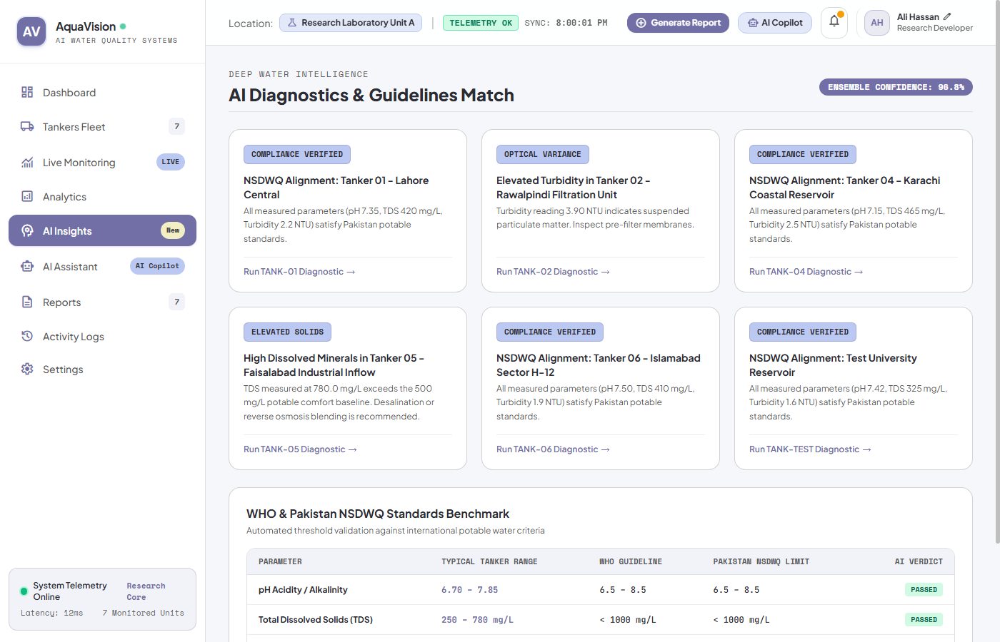
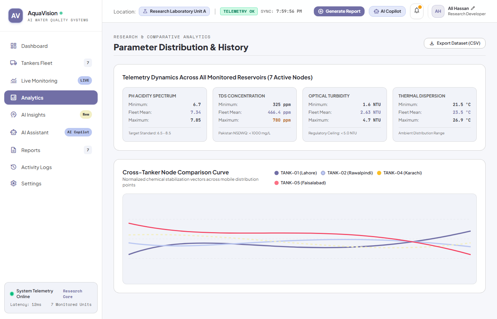
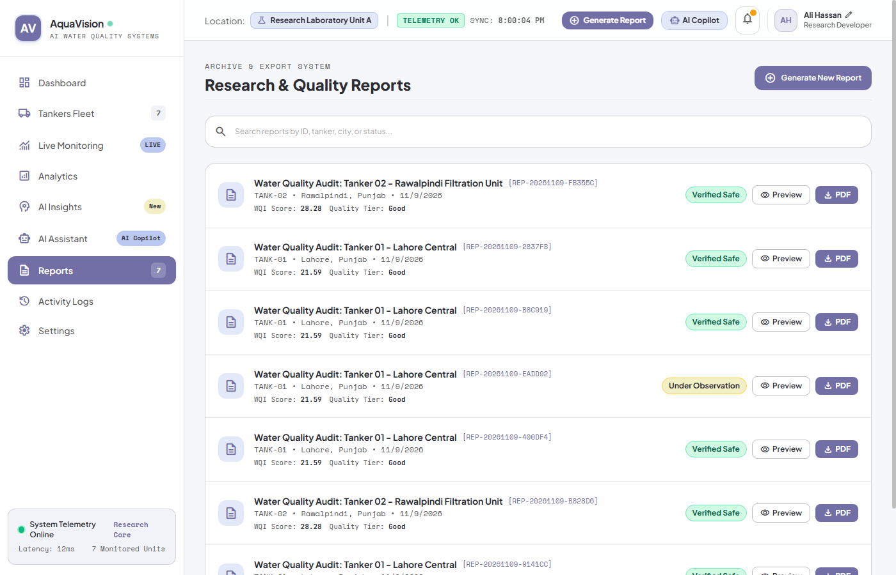
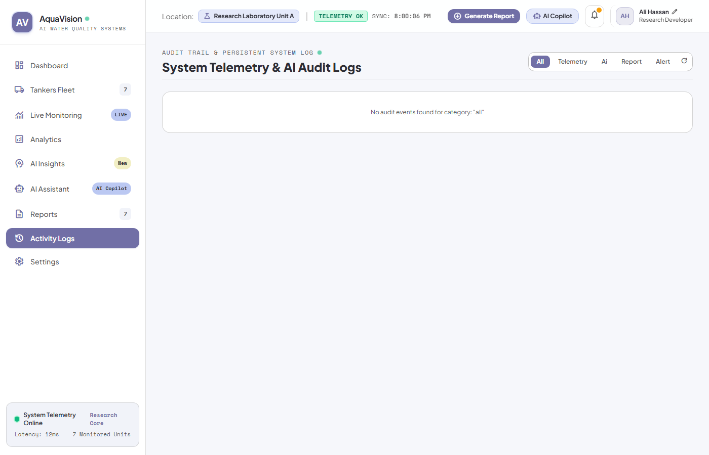

# AquaVision — AI-Based Water Quality Analysis & Monitoring Dashboard

[](https://python.org)
[](https://react.dev)
[](https://fastapi.tiangolo.com)
[](https://langchain-ai.github.io/langgraph/)
[](https://ai.google.dev)
[](https://tailwindcss.com)
[](https://trychroma.com)
[](LICENSE)

---

## Executive Summary

**AquaVision** is an end-to-end, enterprise-grade scientific platform designed for continuous water quality monitoring, autonomous machine-learning diagnostics, and automated regulatory reporting across municipal water supply networks, mobile distribution tankers, and stationary reservoirs in Pakistan.

The platform bridges real-time physical sensor telemetry (pH, TDS, Turbidity, Temperature, Conductivity, Dissolved Oxygen) with pre-trained multi-stage machine learning ensembles (Gradient Boosting, CatBoost, ARIMA) and an agentic **LangGraph** intelligence copilot powered by **Google Gemini**. AquaVision benchmarks incoming sensor streams against **Pakistan National Standards for Drinking Water Quality (NSDWQ)** and **World Health Organization (WHO)** standards to automatically compute Water Quality Indices (WQI), flag hazardous chemical deviations, generate diagnostic laboratory certificates, and compile publication-ready multi-page PDF audit reports.

---

## Research Team & Contributors

This research project unites work across artificial intelligence, machine learning, software architecture, and full-stack systems engineering:

| Contributor | Institutional Role | Research & Implementation Contributions |
| :--- | :--- | :--- |
| **Ali Hassan Azad** | **Lead Full-Stack Engineer, AquaVision Architecture & AI Systems Integration** | **Full-Stack Application Architecture & AI Integration:** Designed and implemented the complete AquaVision platform (`AIWaterQualityProject-AquaVision`), including the responsive React 18 frontend (Tailwind CSS, custom scientific design system) and the asynchronous FastAPI backend; engineered end-to-end integration with the AI team's LangGraph chatbot and report agents; built the dynamic multi-tanker fleet management system, interactive calibrated sensor simulator, and manual lab telemetry influx with boundary validation ($\text{pH} \in [0, 14]$, TDS, Turbidity); engineered persistent SQLite data layer (`reports.db`); developed real-time data-driven SVG telemetry waveforms, dynamic parameter distributions (Min / Avg / Max), and CSV export; created the multi-page ReportLab PDF laboratory report generator with automated section layout; implemented the editable user research profile system and activity audit trail; authored the unified zero-configuration platform launcher (`run_aquavision.py`). |
| **Ahmed Awais** | **AI / ML Integration Specialist** | **Model Connection & Base Workflows:** Created the shared `ModelRunner` (`src/foundation/inference.py`) connecting the AI copilot and report agent to pre-trained Gradient Boosting, CatBoost WQI regressor, and ARIMA forecaster; built foundational LangGraph workflows; authored rule-based Pakistan NSDWQ limit checks (`rules.py`); created the WHO / NSDWQ ChromaDB vector store; built the Word exporter and report template (`sample_report.md`). |
| **Alishba Jawaid** | **Data & RAG Pipeline Engineer** | **Methodology RAG & Speed Optimizations:** Ingested research methodology PDF into ChromaDB (`methodology_rules` collection with Table 1 penalty mappings); linked dataset telemetry with `wqi_full_dataset.csv`; implemented dataset-aware query routing and caching in ChromaDB; optimized query embeddings with Gemini (`gemini-embedding-001`); integrated multi-key fallback (`GEMINI_API_KEY` / `GOOGLE_API_KEY`). |
| **Ali Haider** | **AI Agent & Reliability Engineer** | **Report Agent & Resilience:** Developed interactive sample-entry form for report requests; implemented report-grounded follow-up Q&A (`report_question_node`) answering post-generation queries directly from generated report tables; engineered Gemini failover chain for rate limits and transient pauses; pinned dependency compatibility (`scikit-learn==1.8.0`); created automated unit test suite (16 tests). |

---

## System Architecture



---

## Application Workflow



---

## Visual Feature Showcase

### 1. Executive Monitoring Dashboard
The primary landing screen provides an at-a-glance, balanced overview of fleet health, real-time multi-node telemetry waveforms, and quick executive actions:


### 2. Dedicated Tanker Fleet Management
Full fleet management view allowing scientists and municipal operators to register new distribution units, filter by status, delete with confirmation, and trigger diagnostic audits:


### 3. Real-Time Live Telemetry Acquisition
High-frequency probe stream visualization displaying pH, TDS, Turbidity, and Temperature metrics alongside dynamic chronological waveforms and manual field sensor shift calibration:


### 4. Interactive AI Water Science Copilot
Powered by LangGraph and Google Gemini, the copilot answers scientific inquiries, predicts WQI from ad-hoc measurements, grounds responses in WHO/NSDWQ standards, and embeds interactive report preview cards:


- **Maximized Vertical Chat Area**: Re-architected with a high-efficiency layout where the conversation viewport occupies over 75% of available height with independent smooth scrolling, eliminating page-length overflow.
- **Sleek Single-Row Control Bar**: Consolidates scope selection, active context grounding pill, Gemini model status badge, and conversation reset into a compact ~42px header.
- **Dual Conversation Grounding**:
  - **Overall Fleet Scope**: Access to live tanker counts, cross-tanker comparisons, regional distribution hubs, and water science fundamentals.
  - **Individual Tanker Scope**: Dynamic grounding in specific tanker telemetry (pH, TDS, Turbidity, Nitrate, etc.) and Pakistan NSDWQ thresholds.
- **Compact Horizontal Quick Prompts**: Single-row horizontal scroll bar (`overflow-x-auto`) providing realistic suggested queries without squishing the message area.

### 5. Deep Water Intelligence & Regulatory Benchmarking
Automated rule-based and diagnostic guideline matching engine continuously screening all active nodes against Pakistan NSDWQ and WHO limits:


### 6. Cross-Tanker Parameter Analytics & Distribution
Dynamically computed statistical dispersion (Minimum, Fleet Mean, Maximum) across all registered reservoirs with dataset CSV export:


### 7. Generated Laboratory Reports & PDF Export Archive
Filterable, searchable audit archive of all AI-generated laboratory assessments with instant modal preview and official PDF certificate download:


### 8. Persistent System Audit Trail
Real-time audit log tracking every user login, sensor reading influx, AI invocation, and PDF certificate generation:


---

## AI Assistant — Testing Prompts & Grounded Scenarios

The AquaVision AI Copilot is grounded in live application data and authoritative regulatory standards (Pakistan NSDWQ and WHO). Below are recommended testing prompts categorized by operational and analytical focus:

### 1. General & Fleet-Wide Queries (`Overall Context`)
Select **"🌐 Overall Fleet"** in the top scope selector:
- `How many tankers are currently registered?`
  - *Expected Result:* Returns the exact registered fleet count from SQLite and lists monitored regional hubs across Pakistan.
- `Compare the water quality of all registered tankers`
  - *Expected Result:* Provides a structured comparative breakdown of all tankers with WQI scores, primary telemetry readings, and status indicators.
- `Which tanker currently has the best water quality readings?`
  - *Expected Result:* Dynamically identifies the top-performing distribution unit with optimal WQI and parameter compliance.
- `Which water quality parameters need the most attention?`
  - *Expected Result:* Highlights critical parameters approaching or exceeding regulatory ceilings across the fleet.

### 2. Targeted Tanker Inquiries (`Individual Tanker Context`)
Select an individual unit (e.g., **"🚚 TANK-02: North Sector Reservoir"**) in the top scope selector:
- `Give me a complete overview of this tanker's water quality`
  - *Expected Result:* Returns a diagnostic assessment of the selected tanker's location, source type, WQI rating, and parameter readings.
- `Which parameters are outside their recommended ranges?`
  - *Expected Result:* Compares the tanker's live measurements against Pakistan NSDWQ limits and flags any deviations.
- `Explain the latest readings in simple language`
  - *Expected Result:* Translates technical chemical metrics into easy-to-understand explanations for field operators.
- `What actions would you recommend to improve this tanker's water quality?`
  - *Expected Result:* Offers targeted remediation advice (e.g., sand microfiltration, chlorination adjustment, tank sediment flushing).
- `Generate an official water quality report for this tanker`
  - *Expected Result:* Triggers LangGraph multi-node report generation and returns an embedded interactive card with one-click preview and PDF download.

### 3. Water Science & Educational Questions
Works seamlessly in both Overall and Individual contexts:
- `What is the difference between TDS and turbidity?`
  - *Expected Result:* Explains that TDS measures dissolved mineral ions (< 2 µm, in mg/L), while Turbidity measures suspended particles scattering light (in NTU), along with their distinct health implications.
- `Why is pH important in drinking water?`
  - *Expected Result:* Explains the 6.5–8.5 standard, pipe corrosion at low pH (< 6.5), and compromised chlorine disinfection efficacy at high pH (> 8.0).
- `What can cause high turbidity in drinking water?`
  - *Expected Result:* Details surface runoff, pipe biofilm disturbance, algal blooms, and coagulation-flocculation treatments.
- `What are the health risks of high nitrate levels for children?`
  - *Expected Result:* Details infant methemoglobinemia ("blue baby syndrome"), impaired oxygen transport, and the 50 mg/L regulatory limit.

### 4. WQI & Predictive Inference
- `Explain how the Water Quality Index (WQI) works`
  - *Expected Result:* Explains parameter weighting, sub-index calculation relative to standard limits, and AquaVision's 5-tier classification scale (0–50 Excellent to >300 Unsuitable).
- `Predict WQI for pH 7.2 and TDS 450`
  - *Expected Result:* Runs the CatBoost regressor, notes that unmeasured variables were imputed using regional baseline training medians, and predicts the WQI score and quality tier.

### 5. Conversational & Introductory Queries
- `Hi, what can you help me with?`
  - *Expected Result:* Friendly, structured overview of capabilities, telemetry monitoring, standards grounding, and report generation.

---

## Pre-Trained Machine Learning Pipeline

AquaVision interfaces directly with pre-trained models developed for Pakistan's national groundwater and surface water monitoring dataset (706 samples, 2013–2025):

| Pipeline Stage | Model Type | Checkpoint Path | Purpose & Output |
| :--- | :--- | :--- | :--- |
| **Water Quality Classification** | Tuned Gradient Boosting *(falls back to Random Forest / Decision Tree)* | `AIWaterQualityProject-Chatbot/Classification/Models/final_model.pkl` | Categorizes water sample into 5 standard tiers: `Excellent`, `Good`, `Poor`, `Very Poor`, or `Unsuitable for Drinking` with class probabilities. |
| **WQI Regression** | CatBoost Regressor | `AIWaterQualityProject-Chatbot/Regression/Models/catboost_initial.pkl` | Computes a continuous Water Quality Index (WQI) score from chemical and physical features. |
| **5-Year Risk Forecasting** | ARIMA Time-Series Forecaster | `AIWaterQualityProject-Chatbot/Forecasting/Models/arima_model.pkl` | Generates population-level multi-year baseline risk score projections. |
| **Vector Knowledge Base** | ChromaDB Embedding Index | `AIWaterQualityProject-Chatbot/chroma_db/` | Vectorized embeddings of WHO potable water guidelines, Pakistan NSDWQ statutory limits, and research methodology penalty rules. |

---

## Workspace Directory Structure

```
AIWaterQualityProject/
│
├── AIWaterQualityProject-AquaVision/       # MAIN DEVELOPMENT & INTEGRATION FOLDER
│   ├── backend/                            # FastAPI Application
│   │   ├── main.py                         # REST API Endpoints & Static SPA Serving
│   │   ├── services/
│   │   │   ├── db.py                       # SQLite Database Manager (reports.db)
│   │   │   ├── tanker_service.py           # Tanker CRUD, Influx & Analytics
│   │   │   ├── profile_activity_service.py # User Profile & Audit Logs
│   │   │   ├── ai_service.py               # In-Memory AI Bridge to LangGraph
│   │   │   ├── pdf_generator.py            # Multi-Page ReportLab PDF Generator
│   │   │   └── report_store.py             # Persistent Report Storage
│   │   └── requirements.txt                # Backend Dependencies
│   │
│   ├── frontend/                           # React 18 Application (Vite + Tailwind CSS)
│   │   ├── src/
│   │   │   ├── App.jsx                     # Top-level Routing & State Orchestration
│   │   │   ├── components/
│   │   │   │   ├── ErrorBoundary.jsx       # Non-blocking Runtime Exception Guard
│   │   │   │   ├── Header.jsx              # Dynamic User Profile & Time Sync
│   │   │   │   ├── Sidebar.jsx             # Navigation & Fleet Badges
│   │   │   │   ├── modals/
│   │   │   │   │   ├── ReportPreviewModal.jsx  # Defensive Data Preview Modal
│   │   │   │   │   ├── GenerateReportModal.jsx # Lab Report Generator Modal
│   │   │   │   │   ├── EditProfileModal.jsx    # Scientist Profile Editor
│   │   │   │   │   ├── AddTankerModal.jsx      # Tanker Registration Modal
│   │   │   │   │   └── ManualReadingModal.jsx  # Calibrated Reading Entry
│   │   │   │   └── views/
│   │   │   │       ├── DashboardView.jsx       # Balanced 4-KPI Overview
│   │   │   │       ├── TankerManagementView.jsx# Dedicated Fleet Grid
│   │   │   │       ├── LiveMonitoringView.jsx  # Live Telemetry Stream
│   │   │   │       ├── AnalyticsView.jsx       # Parameter Distribution
│   │   │   │       ├── AIInsightsView.jsx      # Regulatory Benchmarks
│   │   │   │       ├── AIAssistantView.jsx     # Interactive Copilot
│   │   │   │       ├── ReportsView.jsx         # Reports Archive
│   │   │   │       ├── ActivityView.jsx        # Audit Trail
│   │   │   │       └── SettingsView.jsx        # Platform Preferences
│   │   │   └── services/api.js             # Unified REST Client
│   │   ├── dist/                           # Compiled Production Bundle
│   │   └── package.json                    # Frontend Dependencies
│   └── run_aquavision.py                   # Subproject Launcher
│
├── AIWaterQualityProject-Chatbot/          # ORIGINAL AI TEAM REPOSITORY (STRICTLY PRESERVED)
│   ├── Classification/                     # Pre-trained Classification Models & Dataset
│   ├── Regression/                         # Pre-trained CatBoost WQI Regressor
│   ├── Forecasting/                        # Pre-trained ARIMA Time-Series Forecaster
│   ├── chroma_db/                          # Ingested Standards Vector Database
│   ├── src/
│   │   ├── agents/                         # LangGraph Chatbot & Report Graphs
│   │   ├── foundation/                     # ModelRunner, PDF RAG & Rules
│   │   └── main.py                         # CLI Chatbot Entry Point
│   ├── tests/                              # Automated Unit Test Suite (16 tests)
│   └── requirements.txt                    # Chatbot Python Dependencies
│
├── UI-Idea/                                # DESIGN REFERENCE SKETCH
│   ├── DESIGN.md                           # Color & Typography Guidelines
│   ├── code.html                           # Prototype Sketch
│   └── screen.png                          # Initial UI Mockup
│
├── docs/                                   # DOCUMENTATION ASSETS
│   └── assets/screenshots/                 # Actual Application Screenshots
│       ├── dashboard.png
│       ├── tankers.png
│       ├── live_monitoring.png
│       ├── ai_copilot.png
│       ├── ai_insights.png
│       ├── analytics.png
│       ├── reports.png
│       └── activity.png
│
├── .env.example                            # Safe Environment Variable Template
├── .gitignore                              # Production Git Ignore Configuration
├── run_aquavision.py                       # Root Zero-Config Platform Launcher
├── start_aquavision.bat                    # One-Click Windows Launcher
└── README.md                               # Master Project Documentation
```

---

## Installation & Setup

### Prerequisites
- **Python 3.10+** (tested through Python 3.14)
- **Node.js 18+** & **npm**
- **Google Gemini API Key** (obtainable free from [Google AI Studio](https://aistudio.google.com/app/apikey))

### 1. Clone & Environment Configuration
```bash
git clone https://github.com/your-username/AIWaterQualityProject.git
cd AIWaterQualityProject

# Copy environment template
cp .env.example .env
```

Open `.env` and insert your Gemini API Key:
```env
GOOGLE_API_KEY=AIzaSyYourActualKeyHere
GEMINI_API_KEY=AIzaSyYourActualKeyHere
GEMINI_MODEL=gemini-3.1-flash-lite
GEMINI_FALLBACK_MODELS=gemini-3.5-flash-lite,gemini-3.6-flash
EMBEDDING_MODEL=models/gemini-embedding-001
```

### 2. Python Virtual Environment & Dependencies
```bash
# Create and activate virtual environment
python -m venv venv

# Windows:
venv\Scripts\activate
# Linux / macOS:
source venv/bin/activate

# Install backend and chatbot dependencies
pip install -r AIWaterQualityProject-AquaVision/backend/requirements.txt
pip install -r AIWaterQualityProject-Chatbot/requirements.txt
```

### 3. Frontend Production Build
```bash
cd AIWaterQualityProject-AquaVision/frontend
npm install
npm run build
cd ../..
```

---

## Launching AquaVision

### Unified Zero-Configuration Launcher
Run the unified launcher from the project root. This initializes the FastAPI backend, mounts pre-trained ML models, connects LangGraph agents, and serves the compiled React single-page application on a single port:

```bash
python run_aquavision.py
```

*Alternatively on Windows, double-click `start_aquavision.bat`.*

Open your web browser at:
```
http://localhost:8000
```

---

## REST API Documentation

FastAPI automatically generates interactive Swagger documentation accessible at `http://localhost:8000/docs`. Key endpoints include:

| Method | Endpoint | Description | Sample Request / Parameters |
| :--- | :--- | :--- | :--- |
| `GET` | `/api/health` | Service health & active model status | None |
| `GET` | `/api/tankers` | Retrieve all registered tankers & readings | None |
| `POST` | `/api/tankers` | Register a new water tanker unit | `{"id": "TANK-05", "name": "Sector F-10", "city": "Islamabad", "capacity_liters": 15000, "pH": 7.3, "TDS": 320, "Turbidity": 1.8, "Temperature": 22}` |
| `POST` | `/api/tankers/{id}/reading` | Influx a calibrated manual laboratory reading | `{"pH": 7.45, "TDS": 340, "Turbidity": 2.1, "Temperature": 23.0}` |
| `DELETE`| `/api/tankers/{id}` | Remove a tanker unit permanently | None |
| `GET` | `/api/analytics` | Statistical distribution (Min / Avg / Max) | None |
| `GET` | `/api/insights` | Derived regulatory violation screening | None |
| `POST` | `/api/chat` | Communicate with LangGraph AI Copilot | `{"message": "What is the WHO limit for arsenic?", "session_id": "user-1"}` |
| `POST` | `/api/reports/generate` | Trigger full AI report compilation | `{"tanker_id": "TANK-01", "session_id": "user-1"}` |
| `GET` | `/api/reports` | List all persistent laboratory reports | `?limit=50` |
| `GET` | `/api/reports/{id}/pdf` | Download official multi-page PDF certificate | None (Binary `%PDF` stream) |
| `GET` | `/api/profile` | Retrieve authenticated scientist profile | None |
| `PUT` | `/api/profile` | Update scientist profile & organization | `{"name": "Ali Hassan", "designation": "Research Developer", "role": "Administrator", "organization": "AquaVision"}` |
| `GET` | `/api/activity` | Persistent system audit trail | `?limit=50&category=all` |

---

## Future Physical IoT Sensor Integration Roadmap

AquaVision was architecturally engineered to support physical hardware deployment without modifying the frontend or AI pipelines:

```
[ Physical Probes ]             [ Microcontroller Gateway ]             [ AquaVision Cloud / Edge ]
Analog pH Sensor   ──────┐
Digital TDS Probe  ──────┼────> [ ESP32 / Arduino / Raspberry Pi ] ───> [ POST /api/tankers/{id}/reading ]
Optical Turbidity  ──────┤      (4G LTE / LoRaWAN / WiFi Mesh)          • Real-time WQI Calculation
PT100 Temp Sensor  ──────┘                                              • Automated NSDWQ Alert Trigger
```

1. **Hardware Telemetry Gateway**: ESP32 microcontrollers deployed inside mobile tanker intake manifolds sample telemetry at 15-second intervals.
2. **Standard REST Influx**: The gateway formats JSON payloads and pushes directly to `POST /api/tankers/{id}/reading`.
3. **Automated Event Hooks**: Deviations exceeding NSDWQ tolerances trigger automatic incident logging in `activity_logs` and alert the AI Copilot.

---

## Automated Verification & Test Suite

Run the full automated verification test suite to validate database operations, model inference, and PDF rendering:

```bash
python -c "
import sys
from pathlib import Path
backend_dir = Path('AIWaterQualityProject-AquaVision/backend').resolve()
sys.path.insert(0, str(backend_dir))
chatbot_dir = Path('AIWaterQualityProject-Chatbot').resolve()
sys.path.insert(0, str(chatbot_dir))

from fastapi.testclient import TestClient
from main import app

client = TestClient(app)
assert client.get('/').status_code == 200
assert client.get('/api/tankers').status_code == 200
assert client.get('/api/profile').status_code == 200
assert client.get('/api/insights').status_code == 200
assert client.get('/api/activity').status_code == 200
print('All core API and integration endpoints verified successfully!')
"
```

To run the AI team's original 16 unit tests:
```bash
# Windows PowerShell
$env:PYTHONPATH="AIWaterQualityProject-Chatbot"
python -m unittest discover -s AIWaterQualityProject-Chatbot/tests -v
```

---

## License

This project is released under the **MIT License**. Pre-trained models and dataset references are reserved for academic research and educational evaluation.

---

## Related Repositories

This project is part of a larger AI-based Water Quality Analysis ecosystem, maintained through two separate but interconnected repositories:

- **AIWaterQualityProject-Chatbot:** A standalone AI chatbot focused on conversational water-quality analysis, RAG-based knowledge retrieval, machine learning integration, and automated report generation. It can operate independently without requiring the AquaVision frontend.
- **AIWaterQualityProject-AquaVision:** The complete web-based platform that integrates the chatbot with a React frontend, FastAPI backend, database, analytics dashboard, water-quality monitoring features, and reporting system.

### What They Share
- Both projects focus on AI-powered water-quality analysis.
- Both use the same core chatbot capabilities, water-quality knowledge, and relevant ML integrations.
- Both aim to provide intelligent water-quality insights and automated reporting.

### Key Difference
The standalone chatbot repository focuses on the AI chatbot and its internal workflows, while the AquaVision repository provides a complete application experience by integrating those capabilities into a broader web platform.

**In short:** The chatbot is an independently usable AI component, while AquaVision is the complete platform that brings the chatbot and other water-quality features together.

